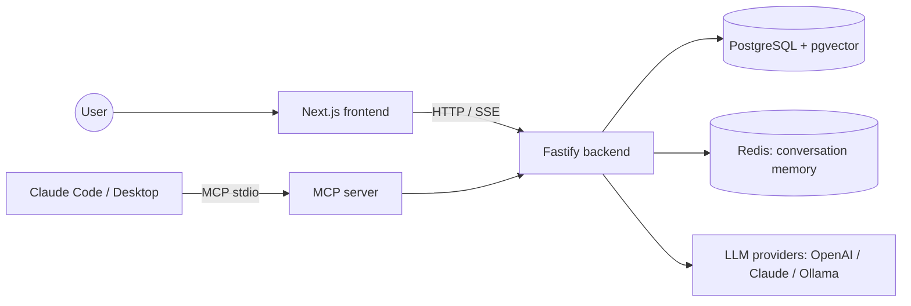

# Architecture

> Living document. Updated as each milestone lands.

## High-level view

## Responsibilities

| Component | Owns |
|-----------|------|
| Frontend | UI only: upload, document list, chat, search. Holds no secrets. |
| Backend | Ingestion, chunking, embeddings, retrieval, RAG, memory, LLM calls, logging. |
| PostgreSQL | Documents, chunks, embedding vectors (pgvector HNSW), full-text index. |
| Redis | Short-term conversation state per user/session. |
| MCP server | Exposes `search_documents` and `ask_question` tools to Claude over stdio. |
| Evaluation | Golden Q&A set, retrieval hit rate, faithfulness, cost/latency reports. |

## Two core flows (filled in at Milestones 5 to 9)

1. **Ingestion:** file → extract text → chunk → embed → store.
2. **Question answering:** question → retrieve (hybrid) → build prompt → LLM → stream answer + citations.
