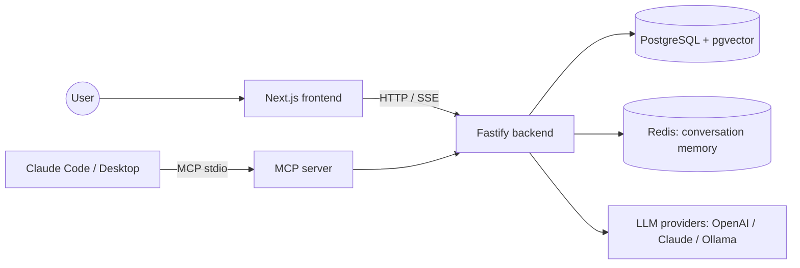
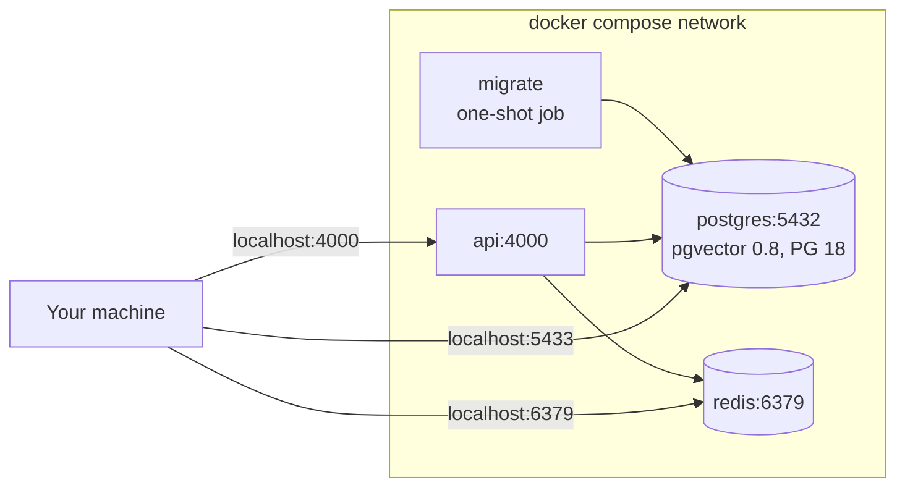

# Architecture

> Living document. Updated as each milestone lands.

## High-level view

## Responsibilities

| Component | Owns |
|-----------|------|
| Frontend | UI only: upload, document list, chat, search. Holds no secrets. |
| Backend | Ingestion, chunking, embeddings, retrieval, RAG, memory, LLM calls, logging. |
| PostgreSQL | Documents, chunks, embedding vectors (pgvector HNSW), full-text index. |
| Redis | Short-term conversation state per user/session. |
| MCP server | Exposes `search_documents` and `ask_question` tools to Claude over stdio. |
| Evaluation | Golden Q&A set, retrieval hit rate, faithfulness, cost/latency reports. |

## Runtime (Docker Compose)

Startup order: `postgres` healthy → `migrate` exits 0 → `api` starts (also waits for `redis` healthy).

| Endpoint | Question it answers | Checks deps? | On failure |
|---|---|---|---|
| `GET /health` | Is the process alive? | No | Orchestrator restarts the container |
| `GET /ready` | Can it serve traffic now? | Postgres + Redis (2s timeout each) | Load balancer stops routing to it |

## Two core flows (filled in at Milestones 5 to 9)

1. **Ingestion:** file → detect type (by bytes) → extract text → chunk (headings/pages, then size)
   → embed `heading + content` (OpenAI, batches of 100) → one transaction: upsert document,
   replace chunks + vectors. Implemented in `backend/src/ingestion/` and `backend/src/embeddings/`.
2. **Search (Milestone 7):** query → in parallel: embed + vector search (HNSW, same model only)
   and keyword search (`search_tsv` GIN, OR of stemmed words) → Reciprocal Rank Fusion → top K
   chunks with filename/heading/page for citations. Implemented in `backend/src/search/`.
3. **Question answering:** question → retrieve (hybrid search above) → build prompt → LLM → stream answer + citations.
